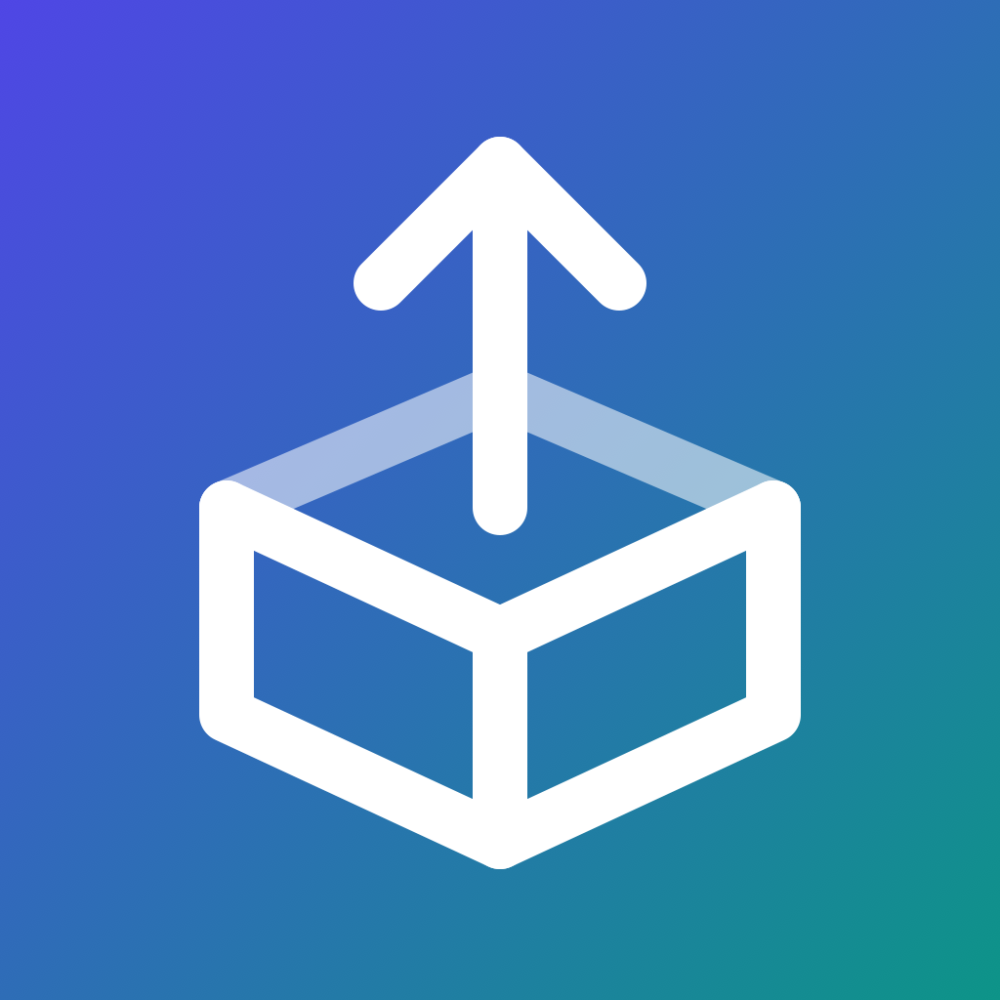

  

<h1 align="center">AppShipKit</h1>

Open-source tools for building, testing and shipping Android and iOS apps.

---

### 🧰 Debug tools

| Project | What it does |
|---|---|
| [**DevDeck**](https://github.com/appshipkit/devdeck) | Jetpack Compose debug drawer: network inspector, logs, breadcrumbs, bad-network and low-memory simulators, feature flags and more |

### 🚀 Release automation (GitHub Actions)

| Action | What it does |
|---|---|
| [**Mobile App Version Bump**](https://github.com/appshipkit/mobile-version-bump) | Bumps Android and iOS versions and build numbers from git tags |
| [**Android Gradle Version Increment**](https://github.com/appshipkit/android-version-increment) | Bumps an Android app's semantic version from the latest git tag via Gradle |
| [**Semver Milestone Increment**](https://github.com/appshipkit/milestone-version-increment) | Creates the next semver milestone from the latest git tag |
| [**Store Release Notes**](https://github.com/appshipkit/store-release-notes) | Builds Google Play and App Store release notes from merged pull requests |
| [**Play Rollout Manager**](https://github.com/appshipkit/play-rollout-manager) | Manages Google Play staged rollouts with history, Slack alerts and safety checks |
| [**App Store Phased Release**](https://github.com/appshipkit/appstore-phased-release) | Pauses, resumes or completes App Store phased releases |
| [**App Size Report**](https://github.com/appshipkit/app-size-report) | Compares APK, AAB and IPA sizes against the base branch and comments on the PR |

---

Issues and pull requests are welcome in each repository. Report security problems privately through the repository's <b>Security</b> tab.

